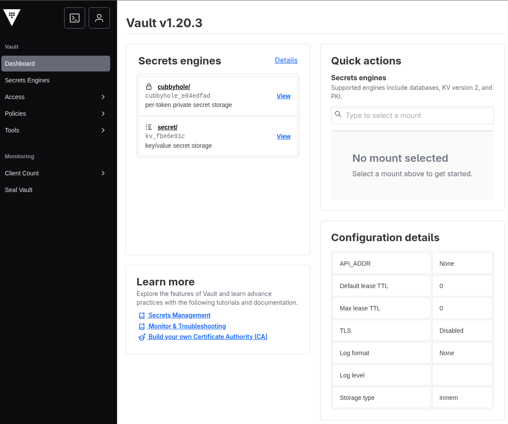

# Spring vault Example

## Description
This project represents an example how to use Spring Vault to save and retrieve secrets from HashiCorp Vault. The advantage of using Spring Vault is
that Vault can rotate the secrets and Spring Vault will automatically retrieve the new secrets without the need to restart the application.

## Features
- Java 23
- Spring Boot 3.5.5
- Spring Cloud Vault 4.0.3
- HashiCorp Vault 1.20.3

## How to start

Run the command:

```bash
$ make start
```

You can start the project with native image with the command:
```bash
$ make native-start
```
With Native Image, applications can run faster, use less memory, and be more secure as shown [here](https://github.com/valdemarjuniorr/spring-boot-graalvm-performance-comparation).

## How to use

To access Vault UI, open your browser and go to [http://localhost:8200](http://localhost:8200). The root token is `myroot`. This token is defined in the `docker-compose.yml` file in the property `VAULT_DEV_ROOT_TOKEN_ID`.
It will open the Vault UI as below:



The default url Vault try to access uses `https` protocol. If you want to use `http` protocol, you need to set the property `spring.cloud.vault.scheme=http` in the `application.yml` file.
You can also access the Vault UI using the command line. Run the command below to login:

```bash
$ docker exec -e VAULT_TOKEN=myroot my-vault vault kv put secret/spring-vault-example database.username=admin database.password=secret123
```


The `secret/spring-vault-example` **MUST** exists in Vault And the ` VAULT_TOKEN` **MUST** be the same as the one defined in the `docker-compose.yml` file.

To check if Vault is working, you can access the url `http://localhost:8080/actuator/health/vault` and it shows as below:

```json
{
  "status": "UP",
  "details": {
    "version": "1.20.3"
  }
}
```

It means that the application is able to connect to Vault.

To check if the secrets are being retrieved from Vault, you can access the url `http://localhost:8080/` and it shows as below:

```
Those values are from Vault: admin:secret123
```

## References
- [Spring Cloud Vault is for secrets, not for configuration](https://www.youtube.com/watch?v=Nw0ROpxyHGE)
